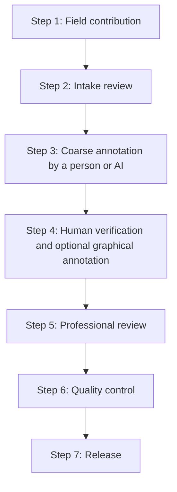

# Dataset Workflow

## Purpose

This document describes how a contribution moves from field photography to a reviewed public dataset release. The workflow is preliminary and will be tested during the MVP stage.

## Roles

- **Field contributor:** emails original photographs and a completed contribution-and-consent form for one building case.
- **Intake reviewer:** checks consent, privacy, eligibility, duplication, and image quality.
- **Annotation volunteer:** records directly visible components, materials, and defects.
- **Professional reviewer:** reviews annotations and may add qualified conservation knowledge.
- **Dataset maintainer:** manages identifiers, versions, quality checks, and releases.

## Contribution Channels

- **Email** is the private intake channel for original field photographs, completed consent forms, basic case information, and permission evidence.
- **GitHub Pull Requests** are the public collaboration channel for documentation, code, vocabulary, validation tools, and annotation work on images that have already passed intake and received stable IDs.

Unreviewed source photographs and private consent material must never be submitted through a public GitHub issue, fork, commit, or Pull Request. A Pull Request does not replace field-data intake or consent review.

## Workflow Stages



### 1. Field contribution

The contributor downloads and completes [`CONTRIBUTION_AND_CONSENT.txt`](CONTRIBUTION_AND_CONSENT.txt), then emails it with the original photographs for one building case. The contributor does not rename or process the photographs. If the attachments are too large, the photographs may be divided across several emails with the same subject and numbered parts. Building stories are encouraged but optional.

### 2. Intake review

An intake reviewer checks:

- whether the building is within project scope;
- whether the contributor has the right to submit the material;
- whether the completed contribution form and all emailed image parts were received;
- whether all required public-release confirmations and any owner, occupant, custodian, or community permissions are complete;
- whether sensitive details require removal, redaction, or restricted access;
- whether the photographs meet minimum quality requirements;
- whether the case duplicates an existing submission.

On receipt, a maintainer replies with a `submission_id` and stores the email, completed form, original photographs, and any permission evidence privately. Only the approved consent and rights status enters the dataset record. After the contribution passes intake, the maintainer assigns the stable `case_id` and `image_id` and creates the working filenames according to the project [naming rules](docs/TASK_PACKAGE_NAMING.md). The original source filename is retained in the private intake record.

### 3. Coarse annotation

Using the identifiers assigned during intake, a person or an AI tool creates one `_annotation.json` file for the image. The file may contain several proposed defect instances, approximate locations, and suggestions for later graphical annotation. It records whether the proposal was created by a person or AI, together with its confidence and provenance. AI-generated results remain unverified until reviewed by a person.

When the annotation task is approved for public collaboration, the annotation file may be proposed through a GitHub Pull Request. The Pull Request must contain no private intake or consent material.

### 4. Fine annotation

An annotation volunteer reviews and confirms or corrects the current `_annotation.json` file. The same file is retained and its state is updated to `fine_annotated`; it is not renamed or copied into a separate fine-annotation file.

Graphical annotation is optional and tracked separately from the text-annotation state. When assigned, a trained volunteer may use LabelMe to mark the location and extent of defects, using the current `_annotation.json` as the source for instance IDs and labels. A `_labelme.json` file may therefore be created while the text annotation is `coarse_annotated`, `fine_annotated`, or `expert_reviewed`.

Fine-annotation and LabelMe changes may also be submitted through an approved GitHub Pull Request when the source image has passed intake and the task contains no restricted material.

### 5. Professional review

Qualified reviewers check annotation accuracy and may add separately identified interpretations, such as possible causes, risk notes, inspection priorities, conservation principles, or discouraged interventions. Disagreement and uncertainty must be preserved rather than hidden.

### 6. Quality control

Dataset maintainers validate required fields, file links, annotation syntax, privacy status, review status, and duplicate checks. Where a LabelMe file exists, its labels, instance links, dimensions, and geometry are also validated. Cases that do not meet release criteria remain unpublished or are rejected with a recorded reason.

### 7. Release

Reviewed records are frozen into a versioned release. GitHub contains project documentation and release notes; Hugging Face will contain the reviewed public data and release-specific Dataset Card.

## Proposed Record States

```text
submitted
privacy_check
coarse_annotated
fine_annotated
expert_reviewed
accepted
rejected
published
withdrawn
```

Graphical annotation has its own status and does not determine the text-annotation state:

```text
not_created
annotated
reviewed
```

## Change Control

Changes to labels, required fields, or review criteria must be versioned. Public releases must remain reproducible even if the working schema later changes.
